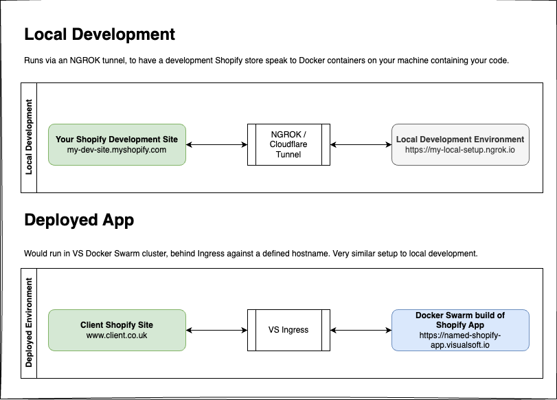

[](https://app.codacy.com?utm_source=gh&utm_medium=referral&utm_content=&utm_campaign=Badge_grade)
[](https://app.codacy.com?utm_source=gh&utm_medium=referral&utm_content=&utm_campaign=Badge_coverage)
[](https://visualsoft.semaphoreci.com/projects/shopify-app-example)


# Shopify App Example

Version: 1.1.0

## Table of Contents

- [Prerequisiti](#prerequisiti)
- [About](#about)
- [Codebase Organisation & Repo Setup](#codebase-organisation--repo-setup)
  - [Laravel & PHP Code](#laravel--php-code)
  - [Front End: CSS & JS](#front-end-css--js)
  - [Shopify Stuff](#shopify-stuff)
  - [CI/CD & Deployments](#cicd--deployments)
  - [Configuring Code Coverage, in Codacy](#configuring-code-coverage-in-codacy)
- [Local Development](#local-development)
  - [Overview of Local Development to Shopify Flow](#overview-of-local-development-to-shopify-flow)
  - [Local Development Steps](#local-development-steps)
  - [Simplified Local Development](#simplified-local-development)
  - [Reverb (WebSockets)](#reverb-websockets)
  - [Common Issues](#common-issues)
    - [Laravel Error: Unable to verify Signature](#laravel-error-unable-to-verify-signature)
    - [Blank screen within Shopify admin, after installing](#blank-screen-within-shopify-admin-after-installing)
    - [App handle must be unique on shopify app deploy or the theme extension not showing](#app-handle-must-be-unique-on-shopify-app-deploy-or-the-theme-extension-not-showing)
- [App Development Processes](#app-development-processes)
- [Further Reading & Viewing](#further-reading--viewing)
- [Building a new app](#building-a-new-app)
  - [New app checklist (Semaphore, handle, Reverb, queues)](#new-app-checklist-semaphore-handle-reverb-queues)
- [Not covered in this project](#not-covered-in-this-project)

## Prerequisiti
```
brew tap shopify/shopify
brew install shopify-cli
shopify app init
shopify app 
```

## About

An example Laravel project, compatible with Visualsoft DevOps requirements, that provides an application base suitable for Shopify App development projects. This has specific functionality to bring the magic of VS3 Snowfall to the Shopify world, along with more sensible defaults:

- A full Semaphore pipeline - including Sentry integration
- Works behind Visualsoft Ingress Layer, enforcing HTTPS
- Provides minimal security headers, including JavaScript nonce
- Can be ran locally with `docker-compose up -d` command, or in Docker Swarm
- Dependabot & Pint integrated via GitHub actions
- Runs the [laravel-shopify](https://github.com/Kyon147/laravel-shopify) package as a base to handle store install/uninstall tasks and provide base scaffold for front end (Liquid templates) and admin (Polaris) output to Shopify

## Codebase Organisation & Repo Setup
How to understand the codebase itself, and configure this as a template for further Shopify Apps.

### Laravel & PHP Code
The app has a default organisation that follows a generalised Domain Driven Development structure.  Namely that has a separation, within the `/app/` directory, across:

- `Application`: Anything that directly interacts with or receives the incoming request (HTTP or CLI) to the application. Namely, Controllers, FormRequests, Middleware & Console command definitions
- `Domain`: Where any of our actual business logic, data entities, functional flow exists.  What makes up the application itself and what it does, essentially.
- `Framework`: Anything that would operate application-wide, across the Domain and/or Application layers. This may include functionality that extends vendor packages

This is on top of the Laravel 12 structure, which itself has been refined and simplified since previous Laravel versions. More information on that is available at https://laravel.com/docs/12.x/structure

All "admin" routes are defined in `routes/admin.php`. These are wrapped behind a `verify.shopify` auth middleware (provided by the `laravel-shopify` package) via the `RouteServiceProvider` class in this project.

### Front End: CSS & JS
- By default, the app is configured to require Node 22+ for builds.
- The app has Tailwind 4 configured by default.
- Builds are using Vite.  [Rollup](https://github.com/rollup/rollup) is incorporated too, as a module bundler for Javascript, to help with optimising builds further and adhere to ES module formats.
- A number of NPM scripts have been defined in `package.json` that help wrap around the Shopify CLI package for various tasks.
- The Shopify ecosystem is heavily built around React.

### Shopify Stuff
- The `extensions/main` directory is where a number of Shopify specific files and assets are stored.  These typically include any Liquid template blocks that might be rendered to the front end, with their associated JS and CSS.  POS extensions and Theme Extensions are commonly what is held in here.
- The `main` part of the extension directory comes from going into the "Build > Extensions" section within your App, in the Shopify Partners portal. `main` is the default.
- The `shopify.extension.toml` file is what is used to define our apps functionality to Shopify, in regards how it extends or adds functionality to Shopify UIs
- Ensure that you give blocks in `extensions/main/blocks` a unique name so that there is no conflicts with other blocks. Use the `vs-project-name` convention
- In order to _generate_ the `shopify.extension.toml` file, inline with the requirement for each environment an App extension is deployed to have a persistent UID value, the `shopify.extension.toml` file is created from a `shopify.extension.tomlsubt` file and created across 4 environments.  See [below for full steps](#extension-toml-files) on this.

### CI/CD & Deployments
Similar to other "next-gen" systems, the Shopify App development flow would be that containers would be build and pushed to Dockyard, before being deployed to Docker Swarm.  As such, the application has a Semaphore CI/CD build structure with appropriate promotion options to build for each environment.

Potential requests to DevOps for new Shopify Apps might include:
- Relevant Sentry project creating, to track errors & exceptions across environments
- Relevant Codacy project configuring and enabling, to track code quality and test coverage (see below)
- Dockyard namespace, to store built containers of the application
- Domain names, for each deployed environment

### Configuring Code Coverage, in Codacy
Code coverage requires a new secret adding into Semaphore, that matches the name defined around line 18 of semaphore.yml.

The following assumes that a cloned repo has been onboarded to Codacy already - if not, add it from https://app.codacy.com/organizations/gh/VisualsoftUK/repositories and click "+ Manage repositories" to add it and have the initial scans run.

That new secret in Semaphore should have 5 environment variables defined:

- `CODACY_PROJECT_TOKEN` - within Codacy, go to Settings > Coverage and grab the Repository API Token
- `CODACY_API_TOKEN` - within Codacy, go to Settings > Coverage and click on the "Using an account API token" and copy the value assigned
- `CODACY_ORGANIZATION_PROVIDER` = "gh"
- `CODACY_USERNAME` = "VisualsoftUK" (GitHub org name)
- `CODACY_PROJECT_NAME` = GitHub repo name

Once this is setup, the PR checks can be enabled within GitHub repo Settings > Branches.  The quality gates can also be configured within Codacy.

## Local Development

### Overview of Local Development to Shopify Flow
The following flowchart gives a visual indicator for how local vs deployed (i.e. acceptance/production etc.) works, running off a website hosted on Shopify for both development and production:



### Local Development Steps

1. Ensure you've created a test Shopify store on the **Visualsoft Test** partner account at https://partners.shopify.com
2. Create a test Shopify App on the **Visualsoft Test** partner account (via Apps > Create app > Create app manually)
3. Ensure that you have installed the Shopify CLI tooling on your machine:
```
brew tap shopify/shopify
brew install shopify-cli
```
4. Install NGROK (https://ngrok.com), optionally claim a static NGROK URL, then run the following:
```
ngrok http 8080
```
5. Go into your test Shopify App and click "Configuration", then set the following URL values:
  - App URL: `NGROK URL` + '/app' e.g. `https://ede3-62-252-202-42.ngrok-free.app/app`
  - Redirect URL: `NGROK URL` + '/authenticate' e.g. `https://ede3-62-252-202-42.ngrok-free.app/authenticate`
  - App URL: `NGROK URL` + '/webhook' e.g. `https://ede3-62-252-202-42.ngrok-free.app/webhook`
6. Create yourself a `.env` file instance by duplicating the `.env.example` file:
```
cp .env.example .env
```
7. From the "Overview" tab within your test Shopify App, copy the Client ID value and paste into your `.env` file as `SHOPIFY_API_KEY`.  Then do the same for Client Secret as `SHOPIFY_API_SECRET`
8. Ensure that the `SHOPIFY_APP_HANDLE` is populated with a unique value - take this from the Configuration tab and App Handle (disabled text box) within your test App in Shopify Partners dashboard
9. Use your NGROK URL in your `.env` file for all relevant URL fields, such as `APP_URL`.  Also use the NGROK URL to repeat step 5 for values such as `SHOPIFY_APP_URL`, `SHOPIFY_APP_REDIRECT_URL`, `SHOPIFY_WEBHOOKS_URL` and `SHOPIFY_APP_PREFERENCES_URL`.
10. Ensure that alL Composer dependencies are installed: 
```
docker run --rm -it -v $PWD:/app:Z -v ~/.composer/auth.json:/root/.github/auth.json:Z dockyard.visualsoft.io/vs-platform/php-cli-8.5:latest composer-install-dev
```
11. Generate your app an `APP_KEY` value in the `.env` file:
```
php artisan key:generate
```
11. Run `./bin/build-shopify-config.sh` that will create a `shopify.app.toml` file from your `.env` file contents
12. Run `shopify app build`
13. Run `nvm exec npm run shopify-ext-dev` to start the theme extension Vite dev server. Assets are generated from files in `extensions/main/frontend/entrypoints`
14. Run `shopify app deploy --no-release`, which should give you a value against the `SHOPIFY_MAIN_ID` as your App Extension ID value in the `.env` file and publish your TOML file contents as a new release version in your App
15. Check the `.env` file contents to make sure that the value for `SHOPIFY_APP_NAME` has not had the "" removed and causing errors with spaces or special characters!
16. Ensure that you run `npm run shopify-dev`
17. Also ensure that `npm run dev` is running so that the App itself is built
18. Run `./bin/build-compose.sh` to bring the containers online (or restart them manually to ensure that any env variables are refreshed)
19. Run the database migrations in the container to create the database tables
```
docker exec -it shopify_feature_view-php-fpm-1 php artisan migrate
```

Refer to Section 7 (slides 33 onwards) in https://docs.google.com/presentation/d/1KYr1ARmqjgC9h5WI6y76Z5vc50NWw78qGv6rPzHttFE/edit?usp=sharing for further reference, and a video of this process if needs be!

### Simplified Local Development
Added via #88 you can run `composer dev` on your machine to wrap around all of the following commands, to run as 1 Terminal output:

- `nvm exec npm run dev` - For running Vite to do the Admin React
- `nvm exec npm run shopify-ext-dev` - For running the extension js/css builds
- `nvm exec npm run shopify-dev` - For running the shopity dev tool to have the app running from your local machine

You will still need to still have NGROK, Docker etc. as well as run the `./bin/build-shopify-config.sh` to create/update the `shopify.app.toml` file, as well as any `extensions/*/shopify.extension.toml` files.

### Reverb (WebSockets)

**Optional.** Only enable Reverb if your app broadcasts real-time events (Laravel Echo / `ShouldBroadcast`). Most cloned apps do not need it for DevOps — leave the Reverb service and related env vars unset in deployed environments unless you add broadcasting.

This template ships with [Laravel Reverb](https://reverb.laravel.com/) for real-time broadcasting. Compose includes a `reverb` service and nginx proxies WebSocket traffic when `NGINX_ENABLE_REVERB=1`.

**Docker (default in `.env.example`)** — `docker-compose up -d` starts Reverb on the internal network (`REVERB_HOST=reverb`, port `8088`, path `/app/websockets`). Clients connect via the public host/scheme (`REVERB_PUBLIC_*` / `VITE_REVERB_*`).

**Laravel Herd** — if you use Herd’s built-in Reverb service instead, comment out the Docker Reverb block in `.env` and use the commented Herd values (`laravel-herd` / `reverb.herd.test`). Omit `REVERB_SERVER_*` when Herd runs the server.

Credentials and both setups are documented in `.env.example`.

### Extension TOML Files
- Starting from a local project, within each `environments/` sub-directory you'd just have the `shopify.extension.tomlsubt` template file.  This template file have have env vars within it, where new ones _may_ need to be added into the `bin/build-shopify-config.sh` script in the repository to pass any new or different ones in.
- Having run `./bin/build-shopify-config.sh` earlier, will have cloned it for each environment (local - as `.toml`, testing as `.toml.testing`, acceptance as `.toml.acceptance` and production as `.toml.production`).
- We'd commit the testing, acceptance and production ones into version control.
- The normal .toml file(s) would only be used for your machines local development and are (now) .gitignore'd.
- Each of the testing, acceptance and production TOML files that are cloned, will need their own UID including to allow the deploy to happen in Semaphore.  That's something we'd need to run the `shopify app deploy --reset command` as a one-off on a machine (not in Semaphore), picking the right account, then the right app.  
- Before doing so, you'd need to remove your local UID value from the .toml file so it doesn't object and just use that. But once you've picked the account and the right app record, it will generate a UID and drop that into your normal .toml file.  You'd then need to copy that out and drop into the relevant testing/acceptance/production equivalent file, before re-setting your local UID back into the file.
- Commit the changes to the testing/acceptance/production TOML file records, per-extension, and you're all good.

### Common Issues

#### Laravel Error: Unable to verify Signature
This can happen after you complete the Local Development Steps above, but you get a Laravel Oh Dear! error screen during the app authentication/installation process.
Typically, this can be resolved by checking the `.env` file values and restarting your Docker containers to make sure they're not cached.

#### Blank screen within Shopify admin, after installing
This can happen after successfully installing your test app on your store, where Shopify can't render the actual App interface.  There is likely some console errors.
Ensure that in your `.env` file that `APP_URL` is the _base_ NGROK URL, rather than "http://localhost". For example:
```
APP_URL=https://ede3-62-252-202-42.ngrok-free.app
```

#### "App handle must be unique" on `shopify app deploy` or the theme extension not showing
Whether you've installed your app and it isn't seemingly showing on the frontend of your site, even though it's installed.  
Or if you get a message when running `shopify app deploy` command that your App Handle must be unique - you're in for a treat...
```
╭─ error ────────────────────────────────────────────────────────────────────────────────────────────────────────╮
│                                                                                                                │
│  Version couldn't be created.                                                                                  │
│                                                                                                                │
│  branding                                                                                                      │
│                                                                                                                │
│  Validation errors                                                                                             │
│    • app_handle: App handle must be unique                                                                     │
│                                                                                                                │
╰────────────────────────────────────────────────────────────────────────────────────────────────────────────────╯
```
This is because the `SHOPIFY_APP_HANDLE` is not defined in your `.env` file.  Or it is defined, but the same app handle is already taken.

Either way, add/edit it to be something unique in your `.env` file.

Then, based on the value entered, you need to _clone_ the definition of `SHOPIFY_MAIN_ID` in your `.env` file. But then rather than "MAIN" in the name of your clone, taken the value of your `SHOPIFY_APP_HANDLE` and use that as uppercase & underscored to replace "MAIN".

As an example:
```env
# My app handle definition that is nice and unique
SHOPIFY_APP_HANDLE=this-is-so-stupid

# The App Extension ID generated for me
SHOPIFY_MAIN_ID=123456abcdef

# My cloned version of App Extension ID, to pair up with my SHOPIFY_APP_HANDLE :rolls-eyes:
SHOPIFY_THIS_IS_SO_STUPID_ID=123456abcdef
```

You _may_ also need to run `nvm exec npm run shopify-ext-dev` or `nvm exec npm run shopify-ext-prod`. That generates `extensions/main/snippets/vite-tag.liquid` and hashed assets from `extensions/main/frontend/entrypoints`. `shopify-dev` is what builds the admin/Polaris stuff. A missing `vite-tag` snippet makes `` fail.

## App Development Processes
The enigmatic @Westie has put together a few pages outlining the approaches taken to working with the various Shopify libraries, APIs and conventions. This is currently in the Wiki of this repository, but we may consolidate things into a centralised Confluence space (or similar) in the future as we build out more of an understanding of things that might be important in the world of Shopify Apps!

https://github.com/VisualsoftUK/shopify-app-example/wiki/

## Further Reading & Viewing
Some useful resources to read and build your understanding and knowledge of how the `laravel-shopify` package can be utilised, as well as the Shopify app ecosystem and libraries.

- https://shopify.dev/docs/apps/launch/built-for-shopify/requirements - Requirements for "Built for Shopify" app status
- https://shopify.dev/docs/apps/build - Shopifys own app development documentation, outlining various concepts, use cases, best practices etc.
- https://shopify.dev/docs/apps/build/app-extensions - Information on App Extensions, and how the `extensions/main/shopify.extension.toml` file allows us to define how Shopify should handle our app and integrate into appropriate UIs
- https://shopify.dev/docs/api/app-bridge - The "App Bridge" is a library that Shopify allows you to define a number of components to render directly into the Shopify admin
- https://polaris-react.shopify.com - Documentation for the Polaris design system and component library that Shopify has built their admin around
- https://github.com/Kyon147/laravel-shopify/wiki - documentation for the `laravel-shopify` package
- https://laracasts.com/series/build-shopify-apps-with-laravel - Laracasts course that works through a practical example of building a Shopify app, using the `laravel-shopify` package
- https://laracasts.com/series/react-from-scratch - Laracasts course for React from Scratch
- https://www.youtube.com/watch?v=j942wKiXFu8&list=PL4cUxeGkcC9gZD-Tvwfod2gaISzfRiP9d - Net Ninja Modern React video tutorial series

## Building a new app

1. Login to https://partners.shopify.com/
2. Choose the Visualsoft Test account; for testing and acceptance - the live account must only be used for production!
3. Go to Apps
4. Create new App
5. Create app manually
6. Type in a name
7. Copy the Client ID and Client Secret
8. Set up your `.env` file - specifically the SHOPIFY_APP_NAME, SHOPIFY_APP_HANDLE, SHOPIFY_API_KEY (Client ID), SHOPIFY_FLAG_CLIENT_ID (Client ID again) and SHOPIFY_API_SECRET (Client Secret) env variables
9. Run `envsubst < shopify.app.toml.envsubst > shopify.app.toml` to create a `shopify.app.toml` file.
10. Run `shopify app build` and `shopify app deploy --no-release` - this will update your `.env` file with a SHOPIFY_MAIN_ID
11. Semaphore secrets must be setup using the same values and referenced in the `.semaphore` yml files. This must be repeated for each environment.

### New app checklist (Semaphore, handle, Reverb, queues)

Use this when cloning the template into a real app.

#### Semaphore rename checklist

Keep the Example placeholder secret names in this template YAML. When you create a new app, rename secrets (and `PROJECT`) in **all** of:

- `.semaphore/semaphore.yml`
- `.semaphore/build/1_testing.yml`
- `.semaphore/build/2_acceptance.yml`
- `.semaphore/build/3_production.yml`
- `.semaphore/tasks/dependency-audit.yml`

Typical renames (replace `Example` / `shopify-app-example` with your app slug):

| Template placeholder | Example for a new app |
|---|---|
| `dockyard - shopify-app-example` | `dockyard - shopify_my_app` |
| `Shopify App - Example (Codacy)` | `Shopify App - My App (Codacy)` |
| `Shopify App - Example (Testing/Acceptance/Production)` | `Shopify App - My App (…)` |
| `shopify-app-example - Sentry` | `shopify_my_app - Sentry` |
| `PROJECT: shopify-app-example` | `PROJECT: shopify_my_app` |

Partner token secrets (`Shopify Partner Token (Testing)` / `(Production)`) usually stay shared across apps.

#### App handle

- Copy `SHOPIFY_APP_HANDLE` from the Partners / Dev Dashboard **Configuration** tab (disabled App Handle field). Do not invent it.
- Shopify may append `-1` (e.g. `my-app-testing-1`) if the bare handle is already taken.
- After deploy, set the matching extension ID env var: `SHOPIFY_MAIN_ID` when the handle is `main`, otherwise `SHOPIFY_<HANDLE_AS_UPPER_SNAKE>_ID` (same value as the theme extension `uid`).

#### Reverb

Optional — only request Reverb from DevOps if the app uses broadcasting. See [Reverb (WebSockets)](#reverb-websockets).

#### Queues and Redis for DevOps

Deployed environments should use Redis for both cache and queues:

```env
QUEUE_CONNECTION=redis
CACHE_DRIVER=redis
REDIS_QUEUE=default
```

Run queue workers listening to at least:

| Queue | Used by |
|---|---|
| `default` | App jobs, Shopify webhook jobs (unless overridden) |
| `shopify-flow` | `TriggerShopifyFlow` (`SHOPIFY_FLOW_QUEUE`, default `shopify-flow`) |
| `app_pricing` | App Pricing sync, entitlements, and webhook jobs |
| `app_usage_metrics` | App Pricing usage metric jobs |
| `mantle_usage_metrics` | Mantle usage / sync jobs (`MANTLE_USAGE_METRICS_QUEUE_NAME`) |

Example:

```bash
php artisan queue:work redis --queue=default,shopify-flow,app_pricing,app_usage_metrics,mantle_usage_metrics
```

Also run Laravel’s scheduler (for Mantle package schedules, failed-job prune, and any app-specific cron).

## Not covered in this project

Some elements remain unexplored:

- https://shopify.dev/docs/apps/launch/billing - Billing for app usage, however the laravel-shopify package should assist with this https://github.com/Kyon147/laravel-shopify/wiki/Creating-a-Billable-App
